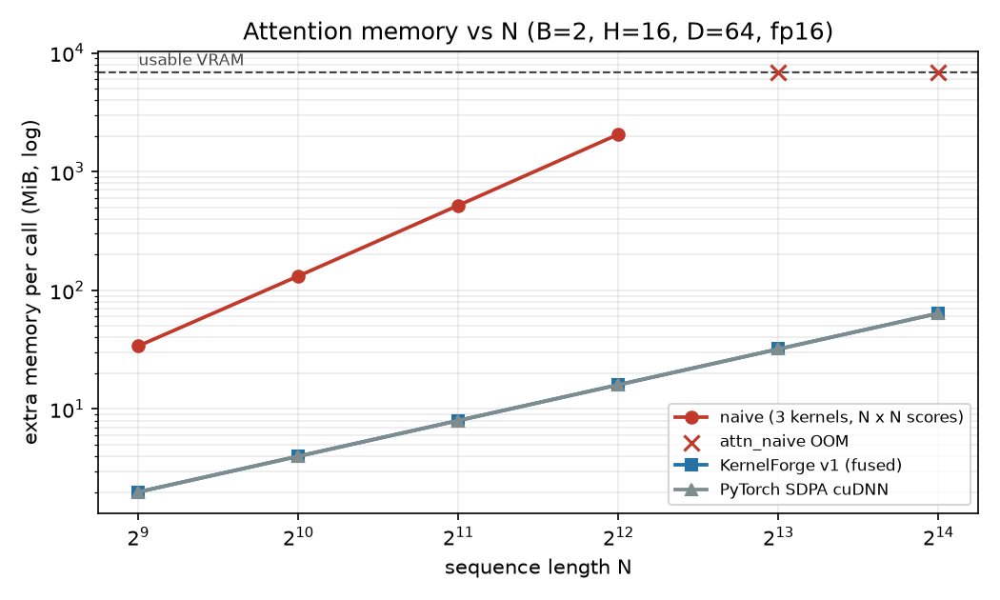

# KernelForge benchmarks

Generated by `scripts/make_report.py` from `results/*.json`. Do not edit by hand.

## Environment

| Field | Value |
|---|---|
| gpu | NVIDIA GeForce RTX 4060 Laptop GPU |
| compute_capability | 8.9 |
| sm_count | 24 |
| driver | 610.60 |
| torch | 2.14.1+cu130 |
| torch_cuda | 13.0 |
| nvcc | 13.0.48 |
| python | 3.12.0 |
| os | Windows-11-10.0.26300-SP0 |
| timestamp | 2026-10-13T16:51:45 |
| power | AC: True, plan: Full Throttle Performance |

## Measured hardware ceilings

Source: `results/hw_ceilings.json` (bench/hw_ceilings.py).

| Property | Value |
|---|---|
| SMs | 24 |
| L2 cache | 32 MiB |
| Shared memory per SM | 100 KiB |
| Shared memory per block (opt-in max) | 99 KiB |
| Registers per SM | 65536 |
| Max threads per SM | 1536 |
| Max SM clock | 2370 MHz |
| Memory bus | 128-bit |

| Measurement | Result |
|---|---|
| DRAM read (float4 kernel) | 248.0 GB/s |
| DRAM copy (float4 kernel, roofline peak) | 234.5 GB/s |
| DRAM write (float4 kernel) | 249.4 GB/s |
| torch copy_ (cross-check) | 225.1 GB/s |
| Theoretical DRAM from clocks (context only) | 256.0 GB/s |
| cuBLAS GEMM fp16_tc_fp32acc (n=4096) | 31.01 TFLOPS |
| cuBLAS GEMM bf16_tc_fp32acc (n=4096) | 30.99 TFLOPS |
| cuBLAS GEMM fp32_simt (n=4096) | 8.50 TFLOPS |
| cuBLAS GEMM fp16_tc_fp16acc_context_only (n=4096) | 57.14 TFLOPS |
| Ridge point, FP16 Tensor Core | 132.2 FLOP/byte |
| Ridge point, FP32 CUDA core | 36.2 FLOP/byte |

## Power limit sensitivity

Source: `results/hw_ceilings_30w.json` (vendor quiet mode, GPU capped at 30 W) vs `results/hw_ceilings.json` (performance mode, 135 W cap). Power draw at the end of each run: 28.63 W vs 134.20 W. Every result in this report uses the 135 W configuration.

| Measurement | 30 W cap | 135 W cap | ratio |
|---|---|---|---|
| DRAM copy (GB/s) | 206.62 | 234.53 | 1.14x |
| fp16_tc_fp32acc (TFLOPS) | 16.53 | 31.01 | 1.88x |
| bf16_tc_fp32acc (TFLOPS) | 17.07 | 30.99 | 1.82x |
| fp32_simt (TFLOPS) | 3.27 | 8.50 | 2.60x |
| fp16_tc_fp16acc_context_only (TFLOPS) | 18.88 | 57.14 | 3.03x |

## Attention: naive baseline vs PyTorch SDPA

Source: `results/attention_naive.json`. Median of 50 timed runs after at least 10 warmup runs. TFLOPS use 4*B*H*N^2*D (halved for causal). `oom` means the run did not fit in the VRAM free at startup (sysmem fallback disabled through the allocator cap). Host launch overhead is excluded by a GPU spin before each timed run. Not available in this torch build: sdpa_flash. cuDNN version: 92400. Measured FP16 Tensor Core ceiling (FP32 accumulate): 31.01 TFLOPS.

| dtype | causal | B | H | N | D | attn_naive ms (TFLOPS) | sdpa_efficient ms (TFLOPS) | sdpa_cudnn ms (TFLOPS) | sdpa_efficient speedup vs naive | sdpa_cudnn speedup vs naive |
|---|---|---|---|---|---|---|---|---|---|---|
| bf16 | no | 2 | 16 | 512 | 64 | 6.620 (0.32) | 0.108 (19.97) | 0.096 (22.31) | 61.6x | 68.8x |
| bf16 | no | 2 | 16 | 1024 | 64 | 26.052 (0.33) | 0.385 (22.31) | 0.357 (24.04) | 67.7x | 72.9x |
| bf16 | no | 2 | 16 | 2048 | 64 | 108.807 (0.32) | 1.459 (23.55) | 1.276 (26.93) | 74.6x | 85.3x |
| bf16 | no | 2 | 16 | 4096 | 64 | 422.960 (0.32) | 5.705 (24.09) | 5.035 (27.30) | 74.1x | 84.0x |
| bf16 | no | 2 | 16 | 8192 | 64 | oom | 23.127 (23.77) | 19.854 (27.69) | - | - |
| bf16 | no | 2 | 16 | 512 | 128 | 12.664 (0.34) | 0.248 (17.33) | 0.184 (23.30) | 51.1x | 68.7x |
| bf16 | no | 2 | 16 | 1024 | 128 | 51.938 (0.33) | 0.945 (18.18) | 0.642 (26.76) | 55.0x | 80.9x |
| bf16 | no | 2 | 16 | 2048 | 128 | 211.365 (0.33) | 3.666 (18.75) | 2.512 (27.36) | 57.7x | 84.1x |
| bf16 | no | 2 | 16 | 4096 | 128 | 823.072 (0.33) | 14.618 (18.80) | 9.935 (27.67) | 56.3x | 82.8x |
| bf16 | no | 2 | 16 | 8192 | 128 | oom | 59.419 (18.50) | 40.578 (27.10) | - | - |
| bf16 | yes | 2 | 16 | 512 | 64 | 3.332 (0.32) | 0.075 (14.37) | 0.084 (12.79) | 44.6x | 39.7x |
| bf16 | yes | 2 | 16 | 1024 | 64 | 13.733 (0.31) | 0.227 (18.90) | 0.250 (17.19) | 60.4x | 55.0x |
| bf16 | yes | 2 | 16 | 2048 | 64 | 57.254 (0.30) | 0.804 (21.37) | 0.807 (21.29) | 71.2x | 71.0x |
| bf16 | yes | 2 | 16 | 4096 | 64 | 222.549 (0.31) | 3.011 (22.83) | 2.865 (23.98) | 73.9x | 77.7x |
| bf16 | yes | 2 | 16 | 8192 | 64 | oom | 11.843 (23.21) | 11.001 (24.99) | - | - |
| bf16 | yes | 2 | 16 | 512 | 128 | 6.511 (0.33) | 0.167 (12.87) | 0.128 (16.78) | 39.0x | 50.9x |
| bf16 | yes | 2 | 16 | 1024 | 128 | 26.113 (0.33) | 0.549 (15.65) | 0.401 (21.40) | 47.6x | 65.1x |
| bf16 | yes | 2 | 16 | 2048 | 128 | 109.289 (0.31) | 1.987 (17.30) | 1.399 (24.56) | 55.0x | 78.1x |
| bf16 | yes | 2 | 16 | 4096 | 128 | 423.400 (0.32) | 7.700 (17.85) | 5.172 (26.57) | 55.0x | 81.9x |
| bf16 | yes | 2 | 16 | 8192 | 128 | oom | 29.810 (18.44) | 20.311 (27.07) | - | - |
| fp16 | no | 2 | 16 | 512 | 64 | 6.504 (0.33) | 0.108 (19.97) | 0.096 (22.31) | 60.5x | 67.6x |
| fp16 | no | 2 | 16 | 1024 | 64 | 25.978 (0.33) | 0.385 (22.31) | 0.357 (24.04) | 67.5x | 72.7x |
| fp16 | no | 2 | 16 | 2048 | 64 | 108.438 (0.32) | 1.461 (23.51) | 1.275 (26.95) | 74.2x | 85.1x |
| fp16 | no | 2 | 16 | 4096 | 64 | 421.988 (0.33) | 5.707 (24.08) | 5.037 (27.29) | 73.9x | 83.8x |
| fp16 | no | 2 | 16 | 8192 | 64 | oom | 23.155 (23.74) | 20.001 (27.49) | - | - |
| fp16 | no | 2 | 16 | 512 | 128 | 12.669 (0.34) | 0.248 (17.33) | 0.184 (23.30) | 51.1x | 68.7x |
| fp16 | no | 2 | 16 | 1024 | 128 | 51.934 (0.33) | 0.945 (18.18) | 0.642 (26.76) | 54.9x | 80.9x |
| fp16 | no | 2 | 16 | 2048 | 128 | 210.868 (0.33) | 3.668 (18.74) | 2.513 (27.35) | 57.5x | 83.9x |
| fp16 | no | 2 | 16 | 4096 | 128 | 822.772 (0.33) | 14.619 (18.80) | 9.797 (28.06) | 56.3x | 84.0x |
| fp16 | no | 2 | 16 | 8192 | 128 | oom | 59.346 (18.53) | 40.572 (27.10) | - | - |
| fp16 | yes | 2 | 16 | 512 | 64 | 3.330 (0.32) | 0.075 (14.36) | 0.084 (12.79) | 44.5x | 39.7x |
| fp16 | yes | 2 | 16 | 1024 | 64 | 13.727 (0.31) | 0.227 (18.89) | 0.250 (17.19) | 60.4x | 54.9x |
| fp16 | yes | 2 | 16 | 2048 | 64 | 57.366 (0.30) | 0.800 (21.48) | 0.807 (21.29) | 71.7x | 71.1x |
| fp16 | yes | 2 | 16 | 4096 | 64 | 222.509 (0.31) | 3.005 (22.87) | 2.865 (23.98) | 74.0x | 77.7x |
| fp16 | yes | 2 | 16 | 8192 | 64 | oom | 11.833 (23.23) | 11.061 (24.85) | - | - |
| fp16 | yes | 2 | 16 | 512 | 128 | 6.386 (0.34) | 0.166 (12.95) | 0.128 (16.78) | 38.5x | 49.9x |
| fp16 | yes | 2 | 16 | 1024 | 128 | 26.189 (0.33) | 0.549 (15.65) | 0.401 (21.40) | 47.7x | 65.2x |
| fp16 | yes | 2 | 16 | 2048 | 128 | 108.743 (0.32) | 1.987 (17.30) | 1.400 (24.55) | 54.7x | 77.7x |
| fp16 | yes | 2 | 16 | 4096 | 128 | 423.370 (0.32) | 7.698 (17.85) | 5.172 (26.57) | 55.0x | 81.9x |
| fp16 | yes | 2 | 16 | 8192 | 128 | oom | 29.816 (18.44) | 20.333 (27.04) | - | - |

## Attention v1: fused, online softmax, FP32 CUDA cores

Sources: `results/attention_v1.json` (v1 and SDPA measured in the same run) and `results/attention_naive.json` (naive). B=2, H=16. v1 does its math as FP32 FMAs on CUDA cores, so its ceiling is the measured FP32 peak, not the Tensor Core peak.

| dtype | causal | N | D | naive ms | v1 ms (TFLOPS) | sdpa_cudnn ms (TFLOPS) | v1 speedup vs naive | v1 % of FP32 peak | v1 % of cuDNN |
|---|---|---|---|---|---|---|---|---|---|
| bf16 | no | 512 | 64 | 6.62 | 1.248 (1.72) | 0.095 (22.55) | 5.3x | 20% | 8% |
| bf16 | no | 1024 | 64 | 26.05 | 4.947 (1.74) | 0.357 (24.04) | 5.3x | 20% | 7% |
| bf16 | no | 2048 | 64 | 108.81 | 19.614 (1.75) | 1.275 (26.95) | 5.5x | 21% | 6% |
| bf16 | no | 4096 | 64 | 422.96 | 78.491 (1.75) | 5.036 (27.29) | 5.4x | 21% | 6% |
| bf16 | no | 8192 | 64 | oom | 311.685 (1.76) | 19.822 (27.74) | - | 21% | 6% |
| bf16 | no | 512 | 128 | 12.66 | 2.544 (1.69) | 0.184 (23.30) | 5.0x | 20% | 7% |
| bf16 | no | 1024 | 128 | 51.94 | 10.317 (1.67) | 0.642 (26.76) | 5.0x | 20% | 6% |
| bf16 | no | 2048 | 128 | 211.37 | 40.067 (1.72) | 2.511 (27.37) | 5.3x | 20% | 6% |
| bf16 | no | 4096 | 128 | 823.07 | 159.827 (1.72) | 9.928 (27.69) | 5.1x | 20% | 6% |
| bf16 | no | 8192 | 128 | oom | 634.853 (1.73) | 39.015 (28.18) | - | 20% | 6% |
| bf16 | yes | 512 | 64 | 3.33 | 0.772 (1.39) | 0.083 (12.95) | 4.3x | 16% | 11% |
| bf16 | yes | 1024 | 64 | 13.73 | 2.763 (1.55) | 0.250 (17.19) | 5.0x | 18% | 9% |
| bf16 | yes | 2048 | 64 | 57.25 | 10.474 (1.64) | 0.806 (21.32) | 5.5x | 19% | 8% |
| bf16 | yes | 4096 | 64 | 222.55 | 40.240 (1.71) | 2.865 (23.99) | 5.5x | 20% | 7% |
| bf16 | yes | 8192 | 64 | oom | 157.700 (1.74) | 10.999 (24.99) | - | 21% | 7% |
| bf16 | yes | 512 | 128 | 6.51 | 1.537 (1.40) | 0.128 (16.78) | 4.2x | 16% | 8% |
| bf16 | yes | 1024 | 128 | 26.11 | 5.483 (1.57) | 0.400 (21.45) | 4.8x | 18% | 7% |
| bf16 | yes | 2048 | 128 | 109.29 | 20.903 (1.64) | 1.397 (24.60) | 5.2x | 19% | 7% |
| bf16 | yes | 4096 | 128 | 423.40 | 81.611 (1.68) | 5.172 (26.58) | 5.2x | 20% | 6% |
| bf16 | yes | 8192 | 128 | oom | 321.175 (1.71) | 20.091 (27.36) | - | 20% | 6% |
| fp16 | no | 512 | 64 | 6.50 | 1.248 (1.72) | 0.095 (22.55) | 5.2x | 20% | 8% |
| fp16 | no | 1024 | 64 | 25.98 | 4.974 (1.73) | 0.356 (24.11) | 5.2x | 20% | 7% |
| fp16 | no | 2048 | 64 | 108.44 | 19.509 (1.76) | 1.275 (26.95) | 5.6x | 21% | 7% |
| fp16 | no | 4096 | 64 | 421.99 | 78.481 (1.75) | 5.036 (27.29) | 5.4x | 21% | 6% |
| fp16 | no | 8192 | 64 | oom | 311.752 (1.76) | 19.823 (27.73) | - | 21% | 6% |
| fp16 | no | 512 | 128 | 12.67 | 2.544 (1.69) | 0.184 (23.30) | 5.0x | 20% | 7% |
| fp16 | no | 1024 | 128 | 51.93 | 10.383 (1.65) | 0.642 (26.76) | 5.0x | 19% | 6% |
| fp16 | no | 2048 | 128 | 210.87 | 40.071 (1.71) | 2.512 (27.36) | 5.3x | 20% | 6% |
| fp16 | no | 4096 | 128 | 822.77 | 159.841 (1.72) | 9.928 (27.69) | 5.1x | 20% | 6% |
| fp16 | no | 8192 | 128 | oom | 634.878 (1.73) | 39.026 (28.17) | - | 20% | 6% |
| fp16 | yes | 512 | 64 | 3.33 | 0.773 (1.39) | 0.083 (12.95) | 4.3x | 16% | 11% |
| fp16 | yes | 1024 | 64 | 13.73 | 2.766 (1.55) | 0.249 (17.26) | 5.0x | 18% | 9% |
| fp16 | yes | 2048 | 64 | 57.37 | 10.437 (1.65) | 0.805 (21.35) | 5.5x | 19% | 8% |
| fp16 | yes | 4096 | 64 | 222.51 | 40.233 (1.71) | 2.865 (23.99) | 5.5x | 20% | 7% |
| fp16 | yes | 8192 | 64 | oom | 170.703 (1.61) | 10.997 (25.00) | - | 19% | 6% |
| fp16 | yes | 512 | 128 | 6.39 | 1.537 (1.40) | 0.128 (16.78) | 4.2x | 16% | 8% |
| fp16 | yes | 1024 | 128 | 26.19 | 5.484 (1.57) | 0.400 (21.45) | 4.8x | 18% | 7% |
| fp16 | yes | 2048 | 128 | 108.74 | 21.021 (1.63) | 1.398 (24.58) | 5.2x | 19% | 7% |
| fp16 | yes | 4096 | 128 | 423.37 | 81.618 (1.68) | 5.173 (26.57) | 5.2x | 20% | 6% |
| fp16 | yes | 8192 | 128 | oom | 321.176 (1.71) | 20.090 (27.36) | - | 20% | 6% |

## Attention v1 tile sweep

Source: `results/attention_v1_sweep.json`. fp16, B=2, H=16, 256 threads per block, geometric mean over N in {1024, 2048, 4096} causal and full. Occupancy is theoretical (registers from ptxas, shared memory from the tile sizes). Chosen defaults: D=64: Br=64, Bc=64, D=128: Br=64, Bc=64.

| D | config | Br | Bc | regs | smem KB | blocks/SM | occupancy | geomean TFLOPS |
|---|---|---|---|---|---|---|---|---|
| 64 | 0 | 32 | 32 | 71 | 20.4 | 3 | 50% (registers) | 1.43 |
| 64 | 1 | 32 | 64 | 72 | 32.5 | 2 | 33% (smem) | 1.49 |
| 64 | 2 | 64 | 32 | 96 | 32.6 | 2 | 33% (smem) | 1.57 |
| 64 | 3 | 64 | 64 | 96 | 48.8 | 2 | 33% (smem) | 1.69 |
| 64 | 4 | 128 | 32 | 123 | 57.1 | 1 | 17% (smem) | 1.62 |
| 128 | 0 | 32 | 32 | 79 | 36.4 | 2 | 33% (smem) | 1.53 |
| 128 | 1 | 32 | 64 | 96 | 56.5 | 1 | 17% (smem) | 1.53 |
| 128 | 2 | 64 | 32 | 116 | 56.6 | 1 | 17% (smem) | 1.59 |
| 128 | 3 | 64 | 64 | 123 | 80.8 | 1 | 17% (smem) | 1.66 |
| 128 | 4 | 128 | 32 | 212 | 97.1 | 1 | 17% (smem) | 1.64 |

## Attention memory vs sequence length

Source: `results/memory_scaling.json`. Extra memory per call beyond the inputs, B=2, H=16, D=64, fp16.

| N | attn_naive MiB | attn_v1 MiB | sdpa_cudnn MiB |
|---|---|---|---|
| 512 | 34.0 | 2.0 | 2.0 |
| 1024 | 132.0 | 4.0 | 4.0 |
| 2048 | 520.0 | 8.0 | 8.0 |
| 4096 | 2064.0 | 16.0 | 16.0 |
| 8192 | oom | 32.0 | 32.0 |
| 16384 | oom | 64.0 | 64.0 |

## Correctness vs FP32 reference

**attn_naive**: 159/159 cases passed (rel err = max|out - ref| / max|ref| over the whole output tensor).

| dtype | cases | worst max abs err | worst max rel err |
|---|---|---|---|
| float16 | 53 | 9.77e-04 | 4.53e-04 |
| bfloat16 | 53 | 7.81e-03 | 3.52e-03 |
| float32 | 53 | 8.34e-07 | 5.43e-07 |

**attn_v1**: 159/159 cases passed (rel err = max|out - ref| / max|ref| over the whole output tensor).

| dtype | cases | worst max abs err | worst max rel err |
|---|---|---|---|
| float16 | 53 | 9.77e-04 | 4.53e-04 |
| bfloat16 | 53 | 7.81e-03 | 3.52e-03 |
| float32 | 53 | 5.36e-05 | 1.26e-05 |

**attn_v1_configs**: 140/140 cases passed (rel err = max|out - ref| / max|ref| over the whole output tensor).

| dtype | cases | worst max abs err | worst max rel err |
|---|---|---|---|
| float16 | 140 | 9.77e-04 | 4.29e-04 |

## Nsight Compute summary

Source: `results/ncu_summary.json`. Profiled with `--set full` at the base clock `ncu` locks to, so durations are longer than the benchmark medians.

| profile | kernel | us | occupancy % | regs | smem B/block | DRAM % | L1/TEX % | L2 hit % | smem bank conflicts | LDS per FFMA | tensor pipe % | top stalls |
|---|---|---|---|---|---|---|---|---|---|---|---|---|
| naive_fp16 | qk_scores_kernel<__half> | 98713.0 | 79.4 | 37 | 0 | 3.5 | 98.6 | 97.5 | 0 | 0.00 | 0.0 | lg_throttle, long_scoreboard, not_selected |
| naive_fp16 | softmax_rows_kernel | 4655.6 | 101.6 | 18 | 128 | 90.3 | 29.2 | 68.7 | 22229 | 0.00 | 0.0 | long_scoreboard, barrier, wait |
| naive_fp16 | pv_kernel<__half> | 22540.4 | 99.3 | 40 | 0 | 12.0 | 97.4 | 83.5 | 0 | 0.00 | 0.0 | long_scoreboard, lg_throttle, not_selected |
| v1_fp16 | void attn_v1_kernel<__half, 64, 64, 64,  | 21966.7 | 32.9 | 96 | 49920 | 1.0 | 98.1 | 94.1 | 22256657 | 1.06 | 0.0 | mio_throttle, not_selected, wait |
