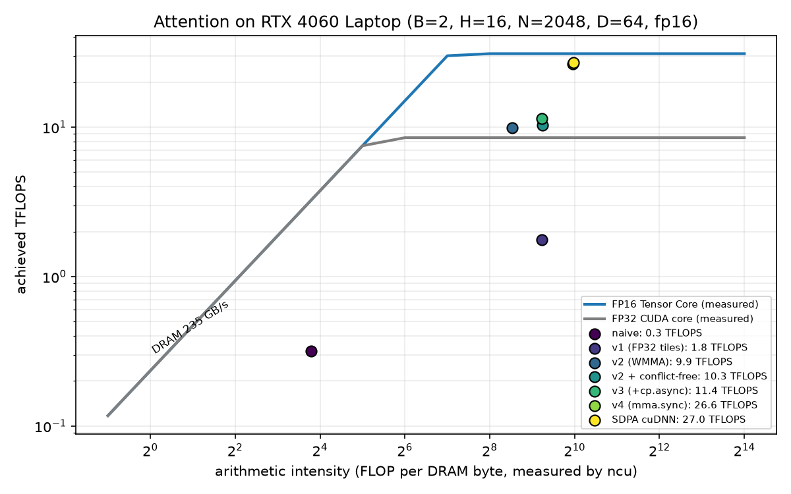

# KernelForge benchmarks

Generated by `scripts/make_report.py` from `results/*.json`. Do not edit by hand.

## Headline results

Measured on an RTX 4060 Laptop GPU (135 W), generated from `results/*.json`. Full tables, protocols and profiler data: [BENCHMARKS.md](BENCHMARKS.md).

| result | measured |
|---|---|
| Fused attention (v4, mma.sync), B=2 H=16 N=2048 D=64 fp16 | **26.44 TFLOPS**, 85% of the measured FP16 Tensor Core peak (31.01 TFLOPS), 83x faster than naive |
| Fused attention vs PyTorch SDPA (cuDNN backend), 40 configs | **100% of cuDNN throughput** (geometric mean, range 82% to 119%), faster on 15 of 40, peak 27.29 TFLOPS |
| Attention extra memory at N=4096 | 2064 MiB (naive, O(N^2)) vs **16 MiB** (fused, O(N)) |
| INT4 dequant GEMV, tinyllama, 7 decoder linears at M=1 | **3.17x faster than cuBLAS FP16**, up to 89% of measured DRAM copy bandwidth |
| INT4 dequant GEMV, qwen2.5-1.5b, 7 decoder linears at M=1 | **3.15x faster than cuBLAS FP16**, up to 90% of measured DRAM copy bandwidth |
| tinyllama batch-1 decode (CUDA graph) | 92.9 tokens/s FP16 vs **212.3 tokens/s INT4** (2.28x), weights 2.05 GiB vs 0.71 GiB |
| qwen2.5-1.5b batch-1 decode (CUDA graph) | 59.0 tokens/s FP16 vs **122.8 tokens/s INT4** (2.08x), weights 2.88 GiB vs 1.06 GiB |
| tinyllama WikiText-2 perplexity | FP16 7.972, KernelForge attention 7.972 (+0.0001), INT4 8.771 (+0.799) |
| qwen2.5-1.5b WikiText-2 perplexity | FP16 9.265, KernelForge attention 9.265 (-0.0000), INT4 10.854 (+1.589) |

## Environment

| Field | Value |
|---|---|
| gpu | NVIDIA GeForce RTX 4060 Laptop GPU |
| compute_capability | 8.9 |
| sm_count | 24 |
| driver | 610.60 |
| torch | 2.14.1+cu130 |
| torch_cuda | 13.0 |
| nvcc | 13.0.48 |
| python | 3.12.0 |
| os | Windows-11-10.0.26300-SP0 |
| timestamp | 2026-10-13T16:51:45 |
| power | AC: True, plan: Full Throttle Performance |

## Measured hardware ceilings

Source: `results/hw_ceilings.json` (bench/hw_ceilings.py).

| Property | Value |
|---|---|
| SMs | 24 |
| L2 cache | 32 MiB |
| Shared memory per SM | 100 KiB |
| Shared memory per block (opt-in max) | 99 KiB |
| Registers per SM | 65536 |
| Max threads per SM | 1536 |
| Max SM clock | 2370 MHz |
| Memory bus | 128-bit |

| Measurement | Result |
|---|---|
| DRAM read (float4 kernel) | 248.0 GB/s |
| DRAM copy (float4 kernel, roofline peak) | 234.5 GB/s |
| DRAM write (float4 kernel) | 249.4 GB/s |
| torch copy_ (cross-check) | 225.1 GB/s |
| Theoretical DRAM from clocks (context only) | 256.0 GB/s |
| cuBLAS GEMM fp16_tc_fp32acc (n=4096) | 31.01 TFLOPS |
| cuBLAS GEMM bf16_tc_fp32acc (n=4096) | 30.99 TFLOPS |
| cuBLAS GEMM fp32_simt (n=4096) | 8.50 TFLOPS |
| cuBLAS GEMM fp16_tc_fp16acc_context_only (n=4096) | 57.14 TFLOPS |
| Ridge point, FP16 Tensor Core | 132.2 FLOP/byte |
| Ridge point, FP32 CUDA core | 36.2 FLOP/byte |

## Power limit sensitivity

Source: `results/hw_ceilings_30w.json` (vendor quiet mode, GPU capped at 30 W) vs `results/hw_ceilings.json` (performance mode, 135 W cap). Power draw at the end of each run: 28.63 W vs 134.20 W. Every result in this report uses the 135 W configuration.

| Measurement | 30 W cap | 135 W cap | ratio |
|---|---|---|---|
| DRAM copy (GB/s) | 206.62 | 234.53 | 1.14x |
| fp16_tc_fp32acc (TFLOPS) | 16.53 | 31.01 | 1.88x |
| bf16_tc_fp32acc (TFLOPS) | 17.07 | 30.99 | 1.82x |
| fp32_simt (TFLOPS) | 3.27 | 8.50 | 2.60x |
| fp16_tc_fp16acc_context_only (TFLOPS) | 18.88 | 57.14 | 3.03x |

## Attention: naive baseline vs PyTorch SDPA

Source: `results/attention_naive.json`. Median of 50 timed runs after at least 10 warmup runs. TFLOPS use 4*B*H*N^2*D (halved for causal). `oom` means the run did not fit in the VRAM free at startup (sysmem fallback disabled through the allocator cap). Host launch overhead is excluded by a GPU spin before each timed run. Not available in this torch build: sdpa_flash. cuDNN version: 92400. Measured FP16 Tensor Core ceiling (FP32 accumulate): 31.01 TFLOPS.

| dtype | causal | B | H | N | D | attn_naive ms (TFLOPS) | sdpa_efficient ms (TFLOPS) | sdpa_cudnn ms (TFLOPS) | sdpa_efficient speedup vs naive | sdpa_cudnn speedup vs naive |
|---|---|---|---|---|---|---|---|---|---|---|
| bf16 | no | 2 | 16 | 512 | 64 | 6.620 (0.32) | 0.108 (19.97) | 0.096 (22.31) | 61.6x | 68.8x |
| bf16 | no | 2 | 16 | 1024 | 64 | 26.052 (0.33) | 0.385 (22.31) | 0.357 (24.04) | 67.7x | 72.9x |
| bf16 | no | 2 | 16 | 2048 | 64 | 108.807 (0.32) | 1.459 (23.55) | 1.276 (26.93) | 74.6x | 85.3x |
| bf16 | no | 2 | 16 | 4096 | 64 | 422.960 (0.32) | 5.705 (24.09) | 5.035 (27.30) | 74.1x | 84.0x |
| bf16 | no | 2 | 16 | 8192 | 64 | oom | 23.127 (23.77) | 19.854 (27.69) | - | - |
| bf16 | no | 2 | 16 | 512 | 128 | 12.664 (0.34) | 0.248 (17.33) | 0.184 (23.30) | 51.1x | 68.7x |
| bf16 | no | 2 | 16 | 1024 | 128 | 51.938 (0.33) | 0.945 (18.18) | 0.642 (26.76) | 55.0x | 80.9x |
| bf16 | no | 2 | 16 | 2048 | 128 | 211.365 (0.33) | 3.666 (18.75) | 2.512 (27.36) | 57.7x | 84.1x |
| bf16 | no | 2 | 16 | 4096 | 128 | 823.072 (0.33) | 14.618 (18.80) | 9.935 (27.67) | 56.3x | 82.8x |
| bf16 | no | 2 | 16 | 8192 | 128 | oom | 59.419 (18.50) | 40.578 (27.10) | - | - |
| bf16 | yes | 2 | 16 | 512 | 64 | 3.332 (0.32) | 0.075 (14.37) | 0.084 (12.79) | 44.6x | 39.7x |
| bf16 | yes | 2 | 16 | 1024 | 64 | 13.733 (0.31) | 0.227 (18.90) | 0.250 (17.19) | 60.4x | 55.0x |
| bf16 | yes | 2 | 16 | 2048 | 64 | 57.254 (0.30) | 0.804 (21.37) | 0.807 (21.29) | 71.2x | 71.0x |
| bf16 | yes | 2 | 16 | 4096 | 64 | 222.549 (0.31) | 3.011 (22.83) | 2.865 (23.98) | 73.9x | 77.7x |
| bf16 | yes | 2 | 16 | 8192 | 64 | oom | 11.843 (23.21) | 11.001 (24.99) | - | - |
| bf16 | yes | 2 | 16 | 512 | 128 | 6.511 (0.33) | 0.167 (12.87) | 0.128 (16.78) | 39.0x | 50.9x |
| bf16 | yes | 2 | 16 | 1024 | 128 | 26.113 (0.33) | 0.549 (15.65) | 0.401 (21.40) | 47.6x | 65.1x |
| bf16 | yes | 2 | 16 | 2048 | 128 | 109.289 (0.31) | 1.987 (17.30) | 1.399 (24.56) | 55.0x | 78.1x |
| bf16 | yes | 2 | 16 | 4096 | 128 | 423.400 (0.32) | 7.700 (17.85) | 5.172 (26.57) | 55.0x | 81.9x |
| bf16 | yes | 2 | 16 | 8192 | 128 | oom | 29.810 (18.44) | 20.311 (27.07) | - | - |
| fp16 | no | 2 | 16 | 512 | 64 | 6.504 (0.33) | 0.108 (19.97) | 0.096 (22.31) | 60.5x | 67.6x |
| fp16 | no | 2 | 16 | 1024 | 64 | 25.978 (0.33) | 0.385 (22.31) | 0.357 (24.04) | 67.5x | 72.7x |
| fp16 | no | 2 | 16 | 2048 | 64 | 108.438 (0.32) | 1.461 (23.51) | 1.275 (26.95) | 74.2x | 85.1x |
| fp16 | no | 2 | 16 | 4096 | 64 | 421.988 (0.33) | 5.707 (24.08) | 5.037 (27.29) | 73.9x | 83.8x |
| fp16 | no | 2 | 16 | 8192 | 64 | oom | 23.155 (23.74) | 20.001 (27.49) | - | - |
| fp16 | no | 2 | 16 | 512 | 128 | 12.669 (0.34) | 0.248 (17.33) | 0.184 (23.30) | 51.1x | 68.7x |
| fp16 | no | 2 | 16 | 1024 | 128 | 51.934 (0.33) | 0.945 (18.18) | 0.642 (26.76) | 54.9x | 80.9x |
| fp16 | no | 2 | 16 | 2048 | 128 | 210.868 (0.33) | 3.668 (18.74) | 2.513 (27.35) | 57.5x | 83.9x |
| fp16 | no | 2 | 16 | 4096 | 128 | 822.772 (0.33) | 14.619 (18.80) | 9.797 (28.06) | 56.3x | 84.0x |
| fp16 | no | 2 | 16 | 8192 | 128 | oom | 59.346 (18.53) | 40.572 (27.10) | - | - |
| fp16 | yes | 2 | 16 | 512 | 64 | 3.330 (0.32) | 0.075 (14.36) | 0.084 (12.79) | 44.5x | 39.7x |
| fp16 | yes | 2 | 16 | 1024 | 64 | 13.727 (0.31) | 0.227 (18.89) | 0.250 (17.19) | 60.4x | 54.9x |
| fp16 | yes | 2 | 16 | 2048 | 64 | 57.366 (0.30) | 0.800 (21.48) | 0.807 (21.29) | 71.7x | 71.1x |
| fp16 | yes | 2 | 16 | 4096 | 64 | 222.509 (0.31) | 3.005 (22.87) | 2.865 (23.98) | 74.0x | 77.7x |
| fp16 | yes | 2 | 16 | 8192 | 64 | oom | 11.833 (23.23) | 11.061 (24.85) | - | - |
| fp16 | yes | 2 | 16 | 512 | 128 | 6.386 (0.34) | 0.166 (12.95) | 0.128 (16.78) | 38.5x | 49.9x |
| fp16 | yes | 2 | 16 | 1024 | 128 | 26.189 (0.33) | 0.549 (15.65) | 0.401 (21.40) | 47.7x | 65.2x |
| fp16 | yes | 2 | 16 | 2048 | 128 | 108.743 (0.32) | 1.987 (17.30) | 1.400 (24.55) | 54.7x | 77.7x |
| fp16 | yes | 2 | 16 | 4096 | 128 | 423.370 (0.32) | 7.698 (17.85) | 5.172 (26.57) | 55.0x | 81.9x |
| fp16 | yes | 2 | 16 | 8192 | 128 | oom | 29.816 (18.44) | 20.333 (27.04) | - | - |

## Attention v1: fused, online softmax, FP32 CUDA cores

Sources: `results/attention_v1.json` (v1 and SDPA measured in the same run) and `results/attention_naive.json` (naive). B=2, H=16. v1 does its math as FP32 FMAs on CUDA cores, so its ceiling is the measured FP32 peak, not the Tensor Core peak.

| dtype | causal | N | D | naive ms | v1 ms (TFLOPS) | sdpa_cudnn ms (TFLOPS) | v1 speedup vs naive | v1 % of FP32 peak | v1 % of cuDNN |
|---|---|---|---|---|---|---|---|---|---|
| bf16 | no | 512 | 64 | 6.62 | 1.248 (1.72) | 0.095 (22.55) | 5.3x | 20% | 8% |
| bf16 | no | 1024 | 64 | 26.05 | 4.947 (1.74) | 0.357 (24.04) | 5.3x | 20% | 7% |
| bf16 | no | 2048 | 64 | 108.81 | 19.614 (1.75) | 1.275 (26.95) | 5.5x | 21% | 6% |
| bf16 | no | 4096 | 64 | 422.96 | 78.491 (1.75) | 5.036 (27.29) | 5.4x | 21% | 6% |
| bf16 | no | 8192 | 64 | oom | 311.685 (1.76) | 19.822 (27.74) | - | 21% | 6% |
| bf16 | no | 512 | 128 | 12.66 | 2.544 (1.69) | 0.184 (23.30) | 5.0x | 20% | 7% |
| bf16 | no | 1024 | 128 | 51.94 | 10.317 (1.67) | 0.642 (26.76) | 5.0x | 20% | 6% |
| bf16 | no | 2048 | 128 | 211.37 | 40.067 (1.72) | 2.511 (27.37) | 5.3x | 20% | 6% |
| bf16 | no | 4096 | 128 | 823.07 | 159.827 (1.72) | 9.928 (27.69) | 5.1x | 20% | 6% |
| bf16 | no | 8192 | 128 | oom | 634.853 (1.73) | 39.015 (28.18) | - | 20% | 6% |
| bf16 | yes | 512 | 64 | 3.33 | 0.772 (1.39) | 0.083 (12.95) | 4.3x | 16% | 11% |
| bf16 | yes | 1024 | 64 | 13.73 | 2.763 (1.55) | 0.250 (17.19) | 5.0x | 18% | 9% |
| bf16 | yes | 2048 | 64 | 57.25 | 10.474 (1.64) | 0.806 (21.32) | 5.5x | 19% | 8% |
| bf16 | yes | 4096 | 64 | 222.55 | 40.240 (1.71) | 2.865 (23.99) | 5.5x | 20% | 7% |
| bf16 | yes | 8192 | 64 | oom | 157.700 (1.74) | 10.999 (24.99) | - | 21% | 7% |
| bf16 | yes | 512 | 128 | 6.51 | 1.537 (1.40) | 0.128 (16.78) | 4.2x | 16% | 8% |
| bf16 | yes | 1024 | 128 | 26.11 | 5.483 (1.57) | 0.400 (21.45) | 4.8x | 18% | 7% |
| bf16 | yes | 2048 | 128 | 109.29 | 20.903 (1.64) | 1.397 (24.60) | 5.2x | 19% | 7% |
| bf16 | yes | 4096 | 128 | 423.40 | 81.611 (1.68) | 5.172 (26.58) | 5.2x | 20% | 6% |
| bf16 | yes | 8192 | 128 | oom | 321.175 (1.71) | 20.091 (27.36) | - | 20% | 6% |
| fp16 | no | 512 | 64 | 6.50 | 1.248 (1.72) | 0.095 (22.55) | 5.2x | 20% | 8% |
| fp16 | no | 1024 | 64 | 25.98 | 4.974 (1.73) | 0.356 (24.11) | 5.2x | 20% | 7% |
| fp16 | no | 2048 | 64 | 108.44 | 19.509 (1.76) | 1.275 (26.95) | 5.6x | 21% | 7% |
| fp16 | no | 4096 | 64 | 421.99 | 78.481 (1.75) | 5.036 (27.29) | 5.4x | 21% | 6% |
| fp16 | no | 8192 | 64 | oom | 311.752 (1.76) | 19.823 (27.73) | - | 21% | 6% |
| fp16 | no | 512 | 128 | 12.67 | 2.544 (1.69) | 0.184 (23.30) | 5.0x | 20% | 7% |
| fp16 | no | 1024 | 128 | 51.93 | 10.383 (1.65) | 0.642 (26.76) | 5.0x | 19% | 6% |
| fp16 | no | 2048 | 128 | 210.87 | 40.071 (1.71) | 2.512 (27.36) | 5.3x | 20% | 6% |
| fp16 | no | 4096 | 128 | 822.77 | 159.841 (1.72) | 9.928 (27.69) | 5.1x | 20% | 6% |
| fp16 | no | 8192 | 128 | oom | 634.878 (1.73) | 39.026 (28.17) | - | 20% | 6% |
| fp16 | yes | 512 | 64 | 3.33 | 0.773 (1.39) | 0.083 (12.95) | 4.3x | 16% | 11% |
| fp16 | yes | 1024 | 64 | 13.73 | 2.766 (1.55) | 0.249 (17.26) | 5.0x | 18% | 9% |
| fp16 | yes | 2048 | 64 | 57.37 | 10.437 (1.65) | 0.805 (21.35) | 5.5x | 19% | 8% |
| fp16 | yes | 4096 | 64 | 222.51 | 40.233 (1.71) | 2.865 (23.99) | 5.5x | 20% | 7% |
| fp16 | yes | 8192 | 64 | oom | 170.703 (1.61) | 10.997 (25.00) | - | 19% | 6% |
| fp16 | yes | 512 | 128 | 6.39 | 1.537 (1.40) | 0.128 (16.78) | 4.2x | 16% | 8% |
| fp16 | yes | 1024 | 128 | 26.19 | 5.484 (1.57) | 0.400 (21.45) | 4.8x | 18% | 7% |
| fp16 | yes | 2048 | 128 | 108.74 | 21.021 (1.63) | 1.398 (24.58) | 5.2x | 19% | 7% |
| fp16 | yes | 4096 | 128 | 423.37 | 81.618 (1.68) | 5.173 (26.57) | 5.2x | 20% | 6% |
| fp16 | yes | 8192 | 128 | oom | 321.176 (1.71) | 20.090 (27.36) | - | 20% | 6% |

## Attention v1 tile sweep

Source: `results/attention_v1_sweep.json`. fp16, B=2, H=16, 256 threads per block, geometric mean over N in {1024, 2048, 4096} causal and full. Occupancy is theoretical (registers from ptxas, shared memory from the tile sizes). Chosen defaults: D=64: Br=64, Bc=64, D=128: Br=64, Bc=64.

| D | config | Br | Bc | regs | smem KB | blocks/SM | occupancy | geomean TFLOPS |
|---|---|---|---|---|---|---|---|---|
| 64 | 0 | 32 | 32 | 71 | 20.4 | 3 | 50% (registers) | 1.43 |
| 64 | 1 | 32 | 64 | 72 | 32.5 | 2 | 33% (smem) | 1.49 |
| 64 | 2 | 64 | 32 | 96 | 32.6 | 2 | 33% (smem) | 1.57 |
| 64 | 3 | 64 | 64 | 96 | 48.8 | 2 | 33% (smem) | 1.69 |
| 64 | 4 | 128 | 32 | 123 | 57.1 | 1 | 17% (smem) | 1.62 |
| 128 | 0 | 32 | 32 | 79 | 36.4 | 2 | 33% (smem) | 1.53 |
| 128 | 1 | 32 | 64 | 96 | 56.5 | 1 | 17% (smem) | 1.53 |
| 128 | 2 | 64 | 32 | 116 | 56.6 | 1 | 17% (smem) | 1.59 |
| 128 | 3 | 64 | 64 | 123 | 80.8 | 1 | 17% (smem) | 1.66 |
| 128 | 4 | 128 | 32 | 212 | 97.1 | 1 | 17% (smem) | 1.64 |

## Attention optimization ablation

Each row adds one optimization to the row above. Representative shape B=2, H=16, N=2048, D=64, fp16, non-causal. The grid column is the geometric-mean speedup over the previous step across every (N, D, causal, dtype) both versions ran.

| step | source | ms | TFLOPS | % of TC peak | speedup vs previous (rep. shape) | speedup vs previous (grid) |
|---|---|---|---|---|---|---|
| naive: 3 kernels, N x N scores in DRAM | `attention_naive.json` | 108.438 | 0.32 | 1% | - | - |
| v1: fused tiles + online softmax, FP32 CUDA cores | `attention_v1.json` | 19.509 | 1.76 | 6% | 5.56x | 5.08x over 32 configs |
| v2: WMMA Tensor Cores (fp16 tiles, padded smem) | `attention_final.json` | 3.440 | 9.99 | 32% | 5.67x | 4.83x over 40 configs |
| + conflict-free softmax/O layout | `attention_final.json` | 3.302 | 10.40 | 34% | 1.04x | 1.06x over 40 configs |
| + cp.async double-buffered K/V (v3) | `attention_final.json` | 3.015 | 11.40 | 37% | 1.10x | 1.12x over 40 configs |
| v4: mma.sync, softmax + O in registers, ldmatrix, XOR swizzle, tuned tiles | `attention_final.json` | 1.299 | 26.44 | 85% | 2.32x | 2.46x over 40 configs |

## Final attention kernel (v4) vs PyTorch SDPA

Source: `results/attention_final.json` (all kernels measured in the same run). B=2, H=16. Across 40 configs, v4 throughput relative to cuDNN SDPA: geometric mean 100%, min 82%, max 119%.

| dtype | causal | N | D | v4 ms (TFLOPS) | sdpa_cudnn ms (TFLOPS) | sdpa_efficient ms (TFLOPS) | v4 % of cuDNN | v4 % of TC peak |
|---|---|---|---|---|---|---|---|---|
| bf16 | no | 512 | 64 | 0.098 (21.83) | 0.095 (22.55) | 0.106 (20.16) | 97% | 70% |
| bf16 | no | 1024 | 64 | 0.337 (25.50) | 0.355 (24.17) | 0.383 (22.43) | 105% | 82% |
| bf16 | no | 2048 | 64 | 1.299 (26.44) | 1.270 (27.06) | 1.453 (23.65) | 98% | 85% |
| bf16 | no | 4096 | 64 | 5.036 (27.29) | 5.036 (27.29) | 5.709 (24.07) | 100% | 88% |
| bf16 | no | 8192 | 64 | 20.238 (27.16) | 19.830 (27.72) | 22.800 (24.11) | 98% | 88% |
| bf16 | no | 512 | 128 | 0.188 (22.80) | 0.183 (23.43) | 0.247 (17.40) | 97% | 74% |
| bf16 | no | 1024 | 128 | 0.708 (24.28) | 0.640 (26.84) | 0.942 (18.24) | 90% | 78% |
| bf16 | no | 2048 | 128 | 2.727 (25.20) | 2.511 (27.37) | 3.664 (18.75) | 92% | 81% |
| bf16 | no | 4096 | 128 | 11.016 (24.95) | 9.930 (27.68) | 14.623 (18.80) | 90% | 80% |
| bf16 | no | 8192 | 128 | 47.339 (23.23) | 39.035 (28.17) | 58.026 (18.95) | 82% | 75% |
| bf16 | yes | 512 | 64 | 0.071 (15.20) | 0.083 (12.95) | 0.075 (14.36) | 117% | 49% |
| bf16 | yes | 1024 | 64 | 0.212 (20.26) | 0.248 (17.33) | 0.227 (18.89) | 117% | 65% |
| bf16 | yes | 2048 | 64 | 0.727 (23.63) | 0.803 (21.40) | 0.799 (21.51) | 110% | 76% |
| bf16 | yes | 4096 | 64 | 2.681 (25.63) | 2.865 (23.99) | 2.985 (23.02) | 107% | 83% |
| bf16 | yes | 8192 | 64 | 10.519 (26.13) | 11.002 (24.98) | 11.767 (23.36) | 105% | 84% |
| bf16 | yes | 512 | 128 | 0.120 (17.92) | 0.128 (16.78) | 0.166 (12.94) | 107% | 58% |
| bf16 | yes | 1024 | 128 | 0.400 (21.45) | 0.398 (21.56) | 0.546 (15.74) | 99% | 69% |
| bf16 | yes | 2048 | 128 | 1.468 (23.41) | 1.398 (24.58) | 1.985 (17.31) | 95% | 75% |
| bf16 | yes | 4096 | 128 | 5.588 (24.59) | 5.170 (26.58) | 7.698 (17.85) | 93% | 79% |
| bf16 | yes | 8192 | 128 | 21.978 (25.01) | 20.096 (27.36) | 29.484 (18.65) | 91% | 81% |
| fp16 | no | 512 | 64 | 0.099 (21.62) | 0.103 (20.76) | 0.108 (19.97) | 104% | 70% |
| fp16 | no | 1024 | 64 | 0.337 (25.50) | 0.355 (24.17) | 0.385 (22.31) | 105% | 82% |
| fp16 | no | 2048 | 64 | 1.299 (26.44) | 1.271 (27.04) | 1.451 (23.68) | 98% | 85% |
| fp16 | no | 4096 | 64 | 5.036 (27.29) | 5.036 (27.29) | 5.709 (24.08) | 100% | 88% |
| fp16 | no | 8192 | 64 | 20.240 (27.16) | 19.832 (27.72) | 22.801 (24.11) | 98% | 88% |
| fp16 | no | 512 | 128 | 0.188 (22.80) | 0.183 (23.43) | 0.247 (17.40) | 97% | 74% |
| fp16 | no | 1024 | 128 | 0.712 (24.14) | 0.640 (26.84) | 0.941 (18.26) | 90% | 78% |
| fp16 | no | 2048 | 128 | 2.730 (25.17) | 2.511 (27.37) | 3.666 (18.75) | 92% | 81% |
| fp16 | no | 4096 | 128 | 11.019 (24.95) | 9.931 (27.68) | 14.622 (18.80) | 90% | 80% |
| fp16 | no | 8192 | 128 | 43.436 (25.31) | 39.038 (28.17) | 57.613 (19.08) | 90% | 82% |
| fp16 | yes | 512 | 64 | 0.070 (15.41) | 0.083 (12.93) | 0.075 (14.36) | 119% | 50% |
| fp16 | yes | 1024 | 64 | 0.211 (20.36) | 0.248 (17.33) | 0.226 (18.98) | 117% | 66% |
| fp16 | yes | 2048 | 64 | 0.727 (23.63) | 0.802 (21.43) | 0.797 (21.56) | 110% | 76% |
| fp16 | yes | 4096 | 64 | 2.686 (25.58) | 2.864 (23.99) | 2.989 (22.99) | 107% | 82% |
| fp16 | yes | 8192 | 64 | 10.515 (26.14) | 10.994 (25.00) | 11.764 (23.37) | 105% | 84% |
| fp16 | yes | 512 | 128 | 0.121 (17.77) | 0.128 (16.78) | 0.166 (12.94) | 106% | 57% |
| fp16 | yes | 1024 | 128 | 0.402 (21.35) | 0.398 (21.56) | 0.546 (15.74) | 99% | 69% |
| fp16 | yes | 2048 | 128 | 1.465 (23.45) | 1.398 (24.58) | 1.986 (17.31) | 95% | 76% |
| fp16 | yes | 4096 | 128 | 5.591 (24.58) | 5.171 (26.58) | 7.490 (18.35) | 92% | 79% |
| fp16 | yes | 8192 | 128 | 21.980 (25.01) | 20.095 (27.36) | 29.487 (18.64) | 91% | 81% |

## Attention v4 occupancy sweep

Source: `results/attention_v4_sweep.json`. fp16, B=2, H=16, geometric mean over N in {1024, 2048, 4096} causal and full. Chosen defaults: D=64: 8 warps, Bc=64, D=128: 4 warps, Bc=32.

| D | config | warps | Br | Bc | regs | smem KB | blocks/SM | occupancy | geomean TFLOPS |
|---|---|---|---|---|---|---|---|---|---|
| 64 | 0 | 4 | 64 | 32 | 96 | 24 | 4 | 33% (smem) | 24.48 |
| 64 | 1 | 4 | 64 | 64 | 126 | 40 | 2 | 17% (smem) | 23.36 |
| 64 | 2 | 8 | 128 | 32 | 100 | 32 | 2 | 33% (registers) | 22.27 |
| 64 | 3 | 8 | 128 | 64 | 126 | 48 | 2 | 33% (smem) | 24.85 |
| 128 | 0 | 4 | 64 | 32 | 167 | 48 | 2 | 17% (smem) | 23.79 |
| 128 | 1 | 4 | 64 | 64 | 166 | 80 | 1 | 8% (smem) | 20.30 |
| 128 | 2 | 8 | 128 | 32 | 174 | 64 | 1 | 17% (smem) | 21.65 |
| 128 | 3 | 8 | 128 | 64 | 184 | 96 | 1 | 17% (smem) | 22.47 |

## Roofline

Source: `results/roofline.json` (scripts/plot_roofline.py). Intensity uses DRAM bytes measured by Nsight Compute, throughput uses the benchmark median.

| kernel | FLOP per DRAM byte | TFLOPS | % of TC peak |
|---|---|---|---|
| naive | 13.9 | 0.32 | 1% |
| v1 (FP32 tiles) | 599.5 | 1.76 | 6% |
| v2 (WMMA) | 368.3 | 9.99 | 32% |
| v2 + conflict-free | 605.0 | 10.40 | 34% |
| v3 (+cp.async) | 601.7 | 11.40 | 37% |
| v4 (mma.sync) | 1004.9 | 26.44 | 85% |
| SDPA cuDNN | 1003.6 | 27.04 | 87% |

## INT4 weight-only GEMM

Source: `results/gemm_final.json` (bench/bench_gemm.py). Group size 128, symmetric INT4 with fp16 scales, fp16 activations. L2 is flushed (by a read) before every timed run. Bandwidth counts packed weights + scales + x + y (fp16 weights for cuBLAS). Measured peaks: copy 234.5 GB/s (the brief's reference), read-only 248.0 GB/s (the real roof of a GEMV, which is almost pure reads).

### Decode (M = 1) per layer shape

| model | layers | N x K | INT4 us | cuBLAS FP16 us | dequant+matmul us | speedup vs cuBLAS | INT4 GB/s | INT4 % copy peak | INT4 % read peak | cuBLAS % copy peak |
|---|---|---|---|---|---|---|---|---|---|---|
| tinyllama | q_proj/o_proj | 2048 x 2048 | 13.3 | 38.9 | 1193.1 | 2.92x | 163.1 | 70% | 66% | 92% |
| tinyllama | k_proj/v_proj | 256 x 2048 | 5.1 | 9.2 | 1083.6 | 1.80x | 53.7 | 23% | 22% | 49% |
| tinyllama | gate_proj/up_proj | 5632 x 2048 | 28.7 | 97.3 | 1956.4 | 3.39x | 208.0 | 89% | 84% | 101% |
| tinyllama | down_proj | 2048 x 5632 | 28.7 | 98.3 | 1990.8 | 3.43x | 208.0 | 89% | 84% | 100% |
| qwen2.5-1.5b | q_proj/o_proj | 1536 x 1536 | 9.2 | 23.6 | 979.5 | 2.56x | 132.7 | 57% | 53% | 86% |
| qwen2.5-1.5b | k_proj/v_proj | 256 x 1536 | 5.1 | 7.2 | 993.3 | 1.40x | 40.3 | 17% | 16% | 47% |
| qwen2.5-1.5b | gate_proj/up_proj | 8960 x 1536 | 33.8 | 115.7 | 2240.0 | 3.42x | 210.6 | 90% | 85% | 102% |
| qwen2.5-1.5b | down_proj | 1536 x 8960 | 33.8 | 116.7 | 2183.8 | 3.45x | 210.6 | 90% | 85% | 101% |

### All 7 linear layers of one decoder layer, by batch M

Sum of per-layer medians (q, k, v, o, gate, up, down). M <= 8 uses the GEMV kernel, M > 8 the Tensor Core GEMM.

| model | M | INT4 fused us | cuBLAS FP16 us | speedup |
|---|---|---|---|---|
| tinyllama | 1 | 122.9 | 389.1 | 3.17x |
| tinyllama | 2 | 126.0 | 399.4 | 3.17x |
| tinyllama | 4 | 158.7 | 397.3 | 2.50x |
| tinyllama | 8 | 220.2 | 397.3 | 1.80x |
| tinyllama | 16 | 227.3 | 407.6 | 1.79x |
| tinyllama | 32 | 254.0 | 407.6 | 1.60x |
| tinyllama | 64 | 345.2 | 426.0 | 1.23x |
| tinyllama | 128 | 531.5 | 547.8 | 1.03x |
| qwen2.5-1.5b | 1 | 130.0 | 409.6 | 3.15x |
| qwen2.5-1.5b | 2 | 140.3 | 420.9 | 3.00x |
| qwen2.5-1.5b | 4 | 181.7 | 422.9 | 2.33x |
| qwen2.5-1.5b | 8 | 236.6 | 420.9 | 1.78x |
| qwen2.5-1.5b | 16 | 242.7 | 423.9 | 1.75x |
| qwen2.5-1.5b | 32 | 247.8 | 438.3 | 1.77x |
| qwen2.5-1.5b | 64 | 347.1 | 449.5 | 1.29x |
| qwen2.5-1.5b | 128 | 574.5 | 625.2 | 1.09x |

## End to end: WikiText-2 perplexity

Source: `results/ppl.json` (bench/ppl_eval.py). WikiText-2 raw test, joined with blank lines, non-overlapping 2048-token windows, last partial window dropped. Models run in fp16. INT4 is round-to-nearest, symmetric, group 128, on every decoder linear layer (embeddings and lm_head stay fp16). The last two columns count attention calls that ran the KernelForge kernel and calls that fell back to SDPA.

| model | config | perplexity | delta vs FP16 | windows | KF attention calls | SDPA fallbacks |
|---|---|---|---|---|---|---|
| tinyllama | FP16 (PyTorch SDPA) | 7.9722 | - | 166 | 0 | 0 |
| tinyllama | KernelForge attention | 7.9723 | +0.0001 | 166 | 3652 | 0 |
| tinyllama | INT4 weights (SDPA) | 8.7714 | +0.7992 | 166 | 0 | 0 |
| tinyllama | INT4 + KernelForge attention | 8.7713 | +0.7991 | 166 | 3652 | 0 |
| qwen2.5-1.5b | FP16 (PyTorch SDPA) | 9.2649 | - | 146 | 0 | 0 |
| qwen2.5-1.5b | KernelForge attention | 9.2649 | -0.0000 | 146 | 4088 | 0 |
| qwen2.5-1.5b | INT4 weights (SDPA) | 10.8537 | +1.5888 | 146 | 0 | 0 |
| qwen2.5-1.5b | INT4 + KernelForge attention | 10.8538 | +1.5889 | 146 | 4088 | 0 |

## End to end: batch-1 decode

Source: `results/e2e.json` (bench/e2e_model.py). Prompt 128 WikiText-2 tokens, 128 greedy decode steps, tokens/sec = 1 / median step time. GPU time share = CUDA kernel time / wall time, from a separate run under torch.profiler (CUPTI).

### PyTorch eager mode

Every step pays Python dispatch and kernel launch overhead for every op of every layer, so the GPU is idle most of the time and faster kernels barely move tokens/sec.

| model | config | tokens/s | step ms | GPU time share | peak VRAM GiB | model GiB |
|---|---|---|---|---|---|---|
| tinyllama | FP16 (PyTorch SDPA) | 10.9 | 92.1 | 21% | 2.07 | 2.05 |
| tinyllama | KernelForge attention | 9.0 | 111.4 | 22% | 2.09 | 2.05 |
| tinyllama | INT4 weights (SDPA) | 7.6 | 131.5 | 23% | 0.75 | 0.71 |
| tinyllama | INT4 + KernelForge attention | 7.6 | 132.1 | 24% | 0.76 | 0.71 |
| qwen2.5-1.5b | FP16 (PyTorch SDPA) | 6.9 | 145.3 | 13% | 2.96 | 2.88 |
| qwen2.5-1.5b | KernelForge attention | 7.6 | 131.5 | 16% | 2.97 | 2.88 |
| qwen2.5-1.5b | INT4 weights (SDPA) | 5.9 | 169.1 | 6% | 1.19 | 1.06 |
| qwen2.5-1.5b | INT4 + KernelForge attention | 7.0 | 141.9 | 11% | 1.21 | 1.06 |

### CUDA graph (one captured decode step, replayed)

Removes the Python and launch overhead, so tokens/sec reflects GPU work. Uses transformers' StaticCache and SDPA attention (a static cache needs a mask, which the KernelForge attention kernel does not take). The last column checks the graph's tokens against eager decode on the same static cache: they must match exactly.

| model | config | tokens/s | step ms | GPU time share | tokens match eager |
|---|---|---|---|---|---|
| tinyllama | FP16 (PyTorch SDPA) | 92.9 | 10.76 | 91% | yes |
| tinyllama | INT4 weights (SDPA) | 212.3 | 4.71 | 81% | yes |
| tinyllama | INT4 speedup over FP16 | 2.28x |  |  |  |
| qwen2.5-1.5b | FP16 (PyTorch SDPA) | 59.0 | 16.96 | 93% | yes |
| qwen2.5-1.5b | INT4 weights (SDPA) | 122.8 | 8.14 | 77% | yes |
| qwen2.5-1.5b | INT4 speedup over FP16 | 2.08x |  |  |  |

## Attention memory vs sequence length

Source: `results/memory_scaling.json`. Extra memory per call beyond the inputs, B=2, H=16, D=64, fp16.

| N | attn_naive MiB | attn_v1 MiB | sdpa_cudnn MiB |
|---|---|---|---|
| 512 | 34.0 | 2.0 | 2.0 |
| 1024 | 132.0 | 4.0 | 4.0 |
| 2048 | 520.0 | 8.0 | 8.0 |
| 4096 | 2064.0 | 16.0 | 16.0 |
| 8192 | oom | 32.0 | 32.0 |
| 16384 | oom | 64.0 | 64.0 |

## Correctness vs FP32 reference

**attn_naive**: 159/159 cases passed (rel err = max|out - ref| / max|ref| over the whole output tensor).

| dtype | cases | worst max abs err | worst max rel err |
|---|---|---|---|
| float16 | 53 | 9.77e-04 | 4.53e-04 |
| bfloat16 | 53 | 7.81e-03 | 3.52e-03 |
| float32 | 53 | 8.34e-07 | 5.43e-07 |

**attn_v1**: 159/159 cases passed (rel err = max|out - ref| / max|ref| over the whole output tensor).

| dtype | cases | worst max abs err | worst max rel err |
|---|---|---|---|
| float16 | 53 | 9.77e-04 | 4.53e-04 |
| bfloat16 | 53 | 7.81e-03 | 3.52e-03 |
| float32 | 53 | 5.36e-05 | 1.26e-05 |

**attn_v1_configs**: 140/140 cases passed (rel err = max|out - ref| / max|ref| over the whole output tensor).

| dtype | cases | worst max abs err | worst max rel err |
|---|---|---|---|
| float16 | 140 | 9.77e-04 | 4.29e-04 |

**attn_v2**: 106/106 cases passed (rel err = max|out - ref| / max|ref| over the whole output tensor).

| dtype | cases | worst max abs err | worst max rel err |
|---|---|---|---|
| float16 | 53 | 1.02e-03 | 4.53e-04 |
| bfloat16 | 53 | 9.93e-03 | 3.52e-03 |

**attn_v3**: 106/106 cases passed (rel err = max|out - ref| / max|ref| over the whole output tensor).

| dtype | cases | worst max abs err | worst max rel err |
|---|---|---|---|
| float16 | 53 | 1.02e-03 | 4.53e-04 |
| bfloat16 | 53 | 9.93e-03 | 3.52e-03 |

**attn_v4**: 106/106 cases passed (rel err = max|out - ref| / max|ref| over the whole output tensor).

| dtype | cases | worst max abs err | worst max rel err |
|---|---|---|---|
| float16 | 53 | 1.02e-03 | 4.53e-04 |
| bfloat16 | 53 | 9.93e-03 | 3.52e-03 |

**attn_v4_configs**: 224/224 cases passed (rel err = max|out - ref| / max|ref| over the whole output tensor).

| dtype | cases | worst max abs err | worst max rel err |
|---|---|---|---|
| float16 | 112 | 1.21e-03 | 5.17e-04 |
| bfloat16 | 112 | 1.07e-02 | 3.63e-03 |

**flash_attn_general**: 168/168 cases passed (rel err = max|out - ref| / max|ref| over the whole output tensor).

| dtype | cases | worst max abs err | worst max rel err |
|---|---|---|---|
| float16 | 84 | 1.31e-03 | 4.59e-04 |
| bfloat16 | 84 | 9.19e-03 | 3.66e-03 |

**int4_gemm**: 144/144 cases passed (rel err = max|out - ref| / max|ref| over the whole output tensor).

| dtype | cases | worst max abs err | worst max rel err |
|---|---|---|---|
| float16 | 144 | 4.19e-03 | 4.83e-04 |

**int4_gemv**: 132/132 cases passed (rel err = max|out - ref| / max|ref| over the whole output tensor).

| dtype | cases | worst max abs err | worst max rel err |
|---|---|---|---|
| float16 | 132 | 3.42e-03 | 4.32e-04 |

**int4_matmul**: 4/4 cases passed (rel err = max|out - ref| / max|ref| over the whole output tensor).

| dtype | cases | worst max abs err | worst max rel err |
|---|---|---|---|
| float16 | 4 | 1.49e-03 | 4.01e-04 |

## Nsight Compute summary

Source: `results/ncu_summary.json`. Profiled with `--set full` at the base clock `ncu` locks to, so durations are longer than the benchmark medians.

| profile | kernel | us | occupancy % | regs | smem B/block | DRAM % | L1/TEX % | L2 hit % | smem bank conflicts | LDS per FFMA | tensor pipe % | top stalls |
|---|---|---|---|---|---|---|---|---|---|---|---|---|
| naive_fp16 | qk_scores_kernel<__half> | 98713.0 | 79.4 | 37 | 0 | 3.5 | 98.6 | 97.5 | 0 | 0.00 | 0.0 | lg_throttle, long_scoreboard, not_selected |
| naive_fp16 | softmax_rows_kernel | 4655.6 | 101.6 | 18 | 128 | 90.3 | 29.2 | 68.7 | 22229 | 0.00 | 0.0 | long_scoreboard, barrier, wait |
| naive_fp16 | pv_kernel<__half> | 22540.4 | 99.3 | 40 | 0 | 12.0 | 97.4 | 83.5 | 0 | 0.00 | 0.0 | long_scoreboard, lg_throttle, not_selected |
| v1_fp16 | void attn_v1_kernel<__half, 64, 64, 64,  | 21966.7 | 32.9 | 96 | 49920 | 1.0 | 98.1 | 94.1 | 22256657 | 1.06 | 0.0 | mio_throttle, not_selected, wait |
| v2_base_fp16 | void attn_v2_kernel<__half, 64, 64> | 4035.9 | 8.3 | 64 | 62464 | 9.0 | 46.0 | 96.3 | 28442624 | 32.24 | 15.2 | wait, short_scoreboard, long_scoreboard |
| v2_layout_fp16 | void attn_v2_kernel<__half, 64, 64, 1> | 3789.1 | 8.3 | 64 | 62464 | 5.9 | 42.2 | 95.9 | 12582912 | 76.24 | 16.2 | wait, short_scoreboard, long_scoreboard |
| v3_fp16 | void attn_v2_kernel<__half, 64, 64, 1, 2 | 3373.4 | 8.3 | 72 | 80896 | 6.6 | 43.6 | 97.1 | 13908300 | 76.24 | 18.2 | wait, short_scoreboard, math_pipe_throttle |
| v4_fp16 | void attn_v4_kernel<__half, 64, 8, 64> | 1449.6 | 32.7 | 128 | 49152 | 9.2 | 24.8 | 91.3 | 13871 | 0.00 | 43.3 | math_pipe_throttle, wait, barrier |
| sdpa_cudnn_fp16 | cudnn_generated_fort_native_sdpa_sm80_fl | 1425.6 | 16.6 | 229 | 73728 | 9.4 | 12.6 | 83.3 | 199 | 0.12 | 44.1 | math_pipe_throttle, barrier, wait |
| cublas_m1_gate | type kernel<int, int, __half, __half, __ | 97.2 | 23.9 | 168 | 272 | 93.4 | 29.3 | 1.0 | 3267 | 0.07 | 0.0 | long_scoreboard, lg_throttle, wait |
| gemv_m1_gate | dequant_gemv_kernel<1> | 26.9 | 57.8 | 60 | 0 | 88.8 | 30.8 | 4.2 | 0 | 0.00 | 0.0 | long_scoreboard, wait, not_selected |
| gemm_m16_gate_bm64 | dequant_gemm_tc_kernel | 70.5 | 22.3 | 108 | 28672 | 36.0 | 36.9 | 52.8 | 155230 | - | 39.3 | math_pipe_throttle, wait, barrier |
| gemm_m16_gate_bm64 | splitk_reduce | 6.0 | 66.2 | 35 | 0 | 64.8 | 8.7 | 22.1 | 0 | - | 0.0 | long_scoreboard, imc_miss, wait |
| gemm_m16_gate | void dequant_gemm_tc_kernel<1, 4, 1, 2> | 47.4 | 33.0 | 70 | 16384 | 58.3 | 35.6 | 52.8 | 152046 | - | 14.7 | long_scoreboard, barrier, wait |
| gemm_m16_gate | splitk_reduce | 6.0 | 69.1 | 35 | 0 | 63.7 | 8.6 | 22.1 | 0 | - | 0.0 | long_scoreboard, imc_miss, wait |
